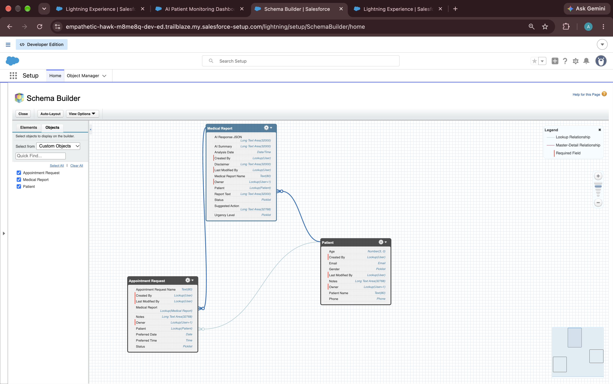
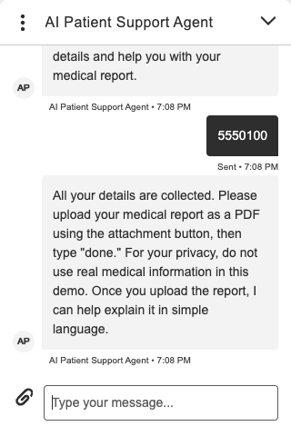
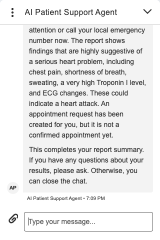

# AI Patient Support & Medical Report Simplifier

A Salesforce-based patient support application that uses Google's Gemini API to turn
medical report text into a plain-language summary, classify its urgency, suggest a next
step, and automatically create an appointment request for high-urgency reports.

Patients can also use an **Agentforce chat agent** on a website: it asks for their
details one at a time, takes the report as a PDF upload, runs the analysis in Salesforce
and explains the result in the conversation.

> This is a patient-support and report-understanding tool. It is not intended to
> diagnose conditions or replace a doctor. Every analysis includes a medical disclaimer.

## Problem Statement

Medical reports often contain complex medical terminology that can be difficult for
patients to understand. Patients may struggle to identify the important findings,
understand the urgency of their reports, and determine what action they should take next.

This project is a Salesforce-based patient support system that uses the Gemini API to
analyze medical report text, generate easy-to-understand summaries, classify the report's
urgency, and suggest appropriate next steps. It also helps manage patient records and
appointment requests, particularly for reports classified as high urgency.

## What It Does

- Accepts medical report text on a Medical Report record.
- Uses the Gemini API to generate a simplified summary.
- Classifies urgency as **Low**, **Moderate** or **High**.
- Suggests a next action and stores a medical disclaimer.
- Stores the analysis and the analysis date on the report in Salesforce.
- Updates the report status based on urgency.
- Automatically creates an Appointment Request for high-urgency reports, without
  creating duplicates.
- Provides list views, reports and a dashboard to monitor reports and appointments.
- Offers a patient chat agent that collects details, accepts a PDF report, analyzes it
  and explains the result in the chat ([docs/agent.md](docs/agent.md)).

| Urgency | Medical Report Status | Appointment Request |
|---|---|---|
| High | Escalated | Created (Status = New), unless one already exists |
| Moderate | In Progress | Not created |
| Low | Reviewed | Not created |

## Tech Stack

Salesforce Platform (Developer Edition) · Apex · SOQL · HTTP callouts · Named and External
Credentials · Gemini API (`gemini-2.5-flash`) · JSON serialization/deserialization ·
Agentforce Service Agent (Agent Script) · Enhanced Chat (Messaging for In-App and Web) ·
Omni-Channel routing flow · Reports and Dashboards · Salesforce CLI · Git and GitHub

## Architecture

```text
Medical Report (Report_Text__c)
        ↓
MedicalReportProcessor.analyzeAndUpdateReport(reportId)
        ↓
GeminiService.analyzeReport(text) ── callout:Gemini_API ──► Gemini API
        ↓                                                    (JSON response)
ReportAnalysisResponse (summary, urgency, recommendation, disclaimer)
        ↓
Medical Report updated: AI Summary, Urgency, Suggested Action,
                        Disclaimer, Status, Analysis Date
        ↓
High urgency and no existing appointment → Appointment Request (New)
        ↓
List views, reports and dashboard
```

Analysis is started by calling `MedicalReportProcessor.analyzeAndUpdateReport(reportId)`,
for example from Anonymous Apex (see `scripts/apex/analyze-report.apex`), or by the chat
agent when a patient uploads a PDF. More detail: [docs/architecture.md](docs/architecture.md).

## Patient Chat Agent

```text
Website chat → Omni-Channel flow → AI_Patient_Support_Agent
   → asks for name, age, gender, email, phone → patient uploads a PDF
   → AgentReportIntake → Gemini (PDF) → Patient, Medical Report, Appointment Request
   → summary, urgency, next step and disclaimer shown in the chat
```

- Asks for each detail in turn and validates them before any analysis.
- Reads the uploaded PDF from the chat session, analyzes it with the same triage rules as
  the rest of the app, and saves the records in one transaction.
- Runs a safety check on every message and directs emergencies to emergency services.
- Answers follow-up questions using only the patient's own results, then closes the
  conversation.

Design and limitations: [docs/agent.md](docs/agent.md) · Setup:
[docs/RECOVERY.md](docs/RECOVERY.md), step 8 · Demo: [docs/DEMO.md](docs/DEMO.md), part 1.

## Data Model

| Object | Purpose | Key fields |
|---|---|---|
| `Patient__c` | Patient information | Age, Gender, Email, Phone, Notes |
| `Medical_Report__c` | Report text and its AI analysis | Patient (lookup), Report Text, AI Summary, Urgency Level, Suggested Action, Disclaimer, Status, Analysis Date |
| `Appointment_Request__c` | Appointment requests for high-urgency reports | Patient (lookup), Medical Report (lookup), Status, Preferred Date, Preferred Time, Notes |

## Apex Classes

| Class | Responsibility |
|---|---|
| `GeminiService` | Builds the prompt (including triage rules), calls Gemini through the Named Credential with JSON mode and temperature 0, and raises `GeminiApiException` on non-200 responses. |
| `MedicalReportProcessor` | Parses the response, applies safe defaults, maps urgency to status, updates the report and creates an appointment for High urgency after checking for an existing one. |
| `ReportAnalysisResponse` | Wrapper class for JSON deserialization. |
| `GeminiMockResponse` | `HttpCalloutMock` used by the tests. |
| `AgentReportIntake` | Chat agent action: validates the patient's details, reads the uploaded PDF, calls Gemini, creates the patient and report records and links the file. |
| `AgentSafetyCheck` | Chat agent action: flags self-harm and medical-emergency messages before the model replies. |

## Security

- The Gemini API key is stored in an encrypted **External Credential** principal parameter
  and added to requests as the `x-goog-api-key` header through a `$Credential` formula.
- The key is not in Apex code, metadata or this repository.
- The chat agent runs as a dedicated agent user with only the permissions it needs, and
  treats uploaded PDFs as data, not instructions.

## Testing

27 Apex unit tests, all passing, with mocked HTTP callouts (no real API calls):

| Class | Coverage |
|---|---|
| `GeminiService` | 100% |
| `MedicalReportProcessor` | 99% |
| `AgentReportIntake` | 98% |
| `AgentSafetyCheck` | 100% |

The tests cover the request configuration, API errors, High urgency with appointment
creation, duplicate prevention, Moderate and Low urgency without appointments, default
values for incomplete AI responses, and for the chat agent: PDF lookup, file type and
size checks, invalid details, and failures that must leave no partial records.

```bash
sf apex run test --class-names GeminiServiceTest --class-names MedicalReportProcessorTest --class-names AgentReportIntakeTest --class-names AgentSafetyCheckTest --code-coverage --result-format human --target-org <alias>
```

The chat agent also has an agent test suite and an end-to-end chat test
(see [docs/agent.md](docs/agent.md#testing)).

## Reports, Dashboard and List Views

- **Reports:** Medical Reports by Urgency, Appointment Requests Overview, Patient Directory
- **Dashboard:** AI Patient Monitoring Dashboard
- **List views:** High Urgency Reports, Recent Medical Reports (last 30 days),
  Pending Appointment Requests (status New)

## Setup

See **[docs/RECOVERY.md](docs/RECOVERY.md)** for step-by-step deployment to a new org. In short:

1. Authorize an org: `sf org login web --alias ai-patient-org --set-default`
2. Deploy: `sf project deploy start --manifest manifest/project-package.xml --test-level RunSpecifiedTests --tests GeminiServiceTest --tests MedicalReportProcessorTest --tests AgentReportIntakeTest --tests AgentSafetyCheckTest`
3. Assign access: `sf org assign permset --name AI_Patient_Support_Access`
4. Add the Gemini API key to the `Gemini_External_Credential` principal (Setup only).
5. Create demo data: `sf apex run --file scripts/apex/create-demo-data.apex`
6. Analyze a report: `sf apex run --file scripts/apex/analyze-report.apex`
7. Optional: set up the chat agent and demo website (RECOVERY.md, step 8).

## Challenges and Solutions

| Challenge | Solution |
|---|---|
| Gemini responses were wrapped in Markdown code blocks, breaking JSON parsing. | Stripped code fences before deserializing; later enabled Gemini JSON response mode. |
| Missing values caused null pointer exceptions. | Added null checks and default values. |
| Repeated analysis created duplicate appointments. | Query for an existing appointment before inserting a new one. |
| The same report was sometimes classified differently. | Added explicit triage rules to the prompt, temperature 0 and no thinking step. |
| API errors surfaced as null pointer exceptions. | Check the HTTP status and raise `GeminiApiException` with Gemini's error message. |
| The API key was stored as plain text in credential metadata. | Moved it to an encrypted External Credential principal parameter. |
| Retrieving the whole org pulled in unrelated standard metadata. | Removed it from the repository and added a project-only deployment manifest (`manifest/project-package.xml`). |
| Agentforce's built-in file handling could not process uploaded PDFs. | Turned it off, let the chat channel store the file on the messaging session, and read the newest PDF from the session in Apex. |
| The agent's Gemini callout failed with a permissions error. | Gave the agent user read access to `UserExternalCredential` through the permission set. |
| The router model sometimes skipped steps or misread short replies such as "no". | Moved flow control into deterministic script logic and wrote the model's instructions as goals and limits. |
| The website chat window showed an error or stayed on "Reconnecting…". | Turned off the channel's fallback message, allowed the website through CORS and trusted framing domains, and used the 15-character org ID in the embed code. |

## Limitations

- In the original workflow, analysis is started manually; only one report can be analyzed
  per transaction because Salesforce does not allow a callout after DML in the same
  transaction.
- The Gemini free tier has a small daily request quota.
- AI output can still vary for borderline reports; it is guidance, not a diagnosis.
- The prompt has no explicit "do not diagnose" instruction, so summaries may mention
  possible conditions. Adding that instruction was tested and reverted because reports
  expected to be Low were classified as Moderate.
- Chat agent: Salesforce's built-in safety layer answers some self-harm messages with a
  generic refusal before the agent's logic runs, so the welcome message always includes
  crisis-helpline guidance. PDFs must be under 2 MB. See [docs/agent.md](docs/agent.md#known-limitations).

## Future Enhancements

- Run analysis asynchronously (Queueable with callouts) so it can start automatically when
  a report is saved.
- Lightning Web Component for patients to view their simplified report.
- Email notifications for high-urgency cases.
- Electronic Health Record (EHR) integration.

## Project Structure

```text
ai-patient-support-agentforce
├── force-app/main/default/
│   ├── classes/            # Apex classes and tests
│   ├── objects/            # Patient, Medical Report, Appointment Request
│   ├── namedCredentials/   # Gemini_API
│   ├── externalCredentials/# Gemini_External_Credential (no secrets)
│   ├── permissionsets/     # AI_Patient_Support_Access
│   ├── aiAuthoringBundles/ # AI_Patient_Support_Agent (Agent Script)
│   ├── aiEvaluationDefinitions/ # Agent test suite
│   ├── flows/  queues/  queueRoutingConfigs/ # Chat routing
│   ├── reports/  dashboards/  reportTypes/
│   └── layouts/  tabs/
├── manifest/
│   ├── project-package.xml        # Project-only deployment manifest
│   └── agent-routing-package.xml  # Chat routing (deployed after agent setup)
├── scripts/
│   ├── apex/               # Demo data and analysis scripts
│   ├── demo-reports/       # Fictional sample PDF reports
│   ├── chat-test-page/     # Local demo website with the chat window
│   └── agent-tests/        # End-to-end chat test
├── specs/                  # Agent test suite specification
├── docs/                   # Architecture, agent design, AI contract, triage rules, recovery guide, demo script
├── screenshots/
└── sfdx-project.json
```

## Screenshots

### Data Model



### Gemini API Integration


### Medical Report Analysis


### Appointment Request


### Dashboard


### High Urgency Reports List View


### Apex Test Results


### Patient Chat: Collecting Details



### Patient Chat: Report Summary



## Author

**Anusha Maggidi**
Aspiring Software Developer passionate about building AI-powered solutions and solving
real-world problems through technology.
GitHub: https://github.com/maggidi-anusha
