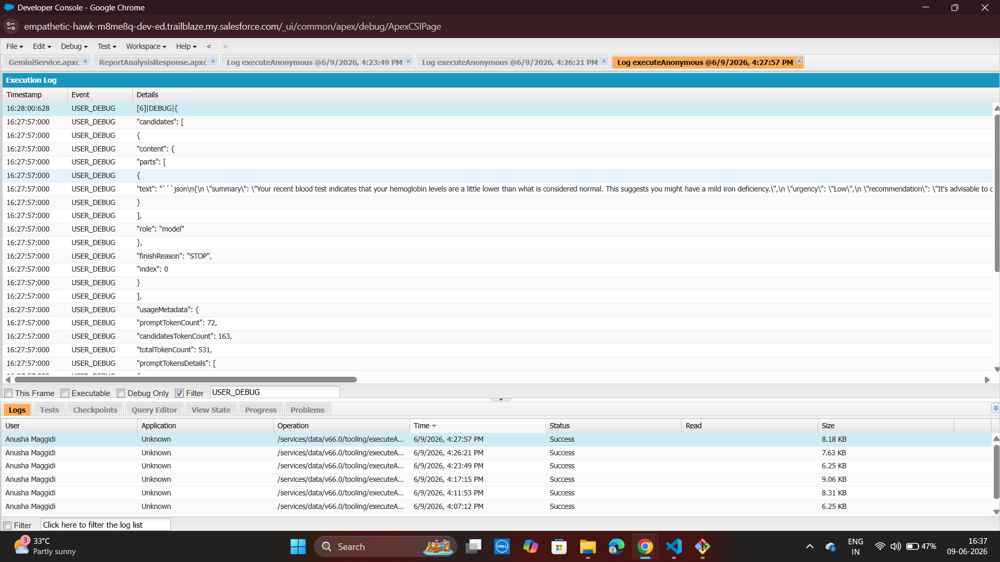
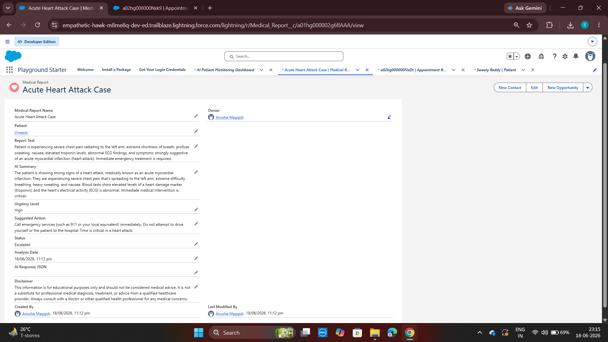
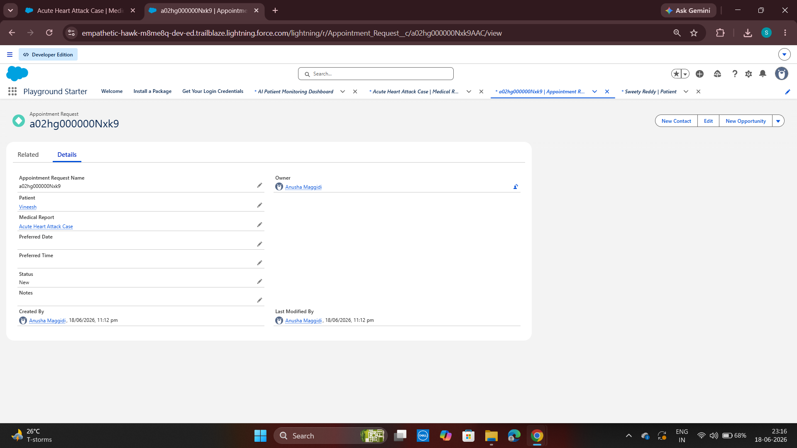
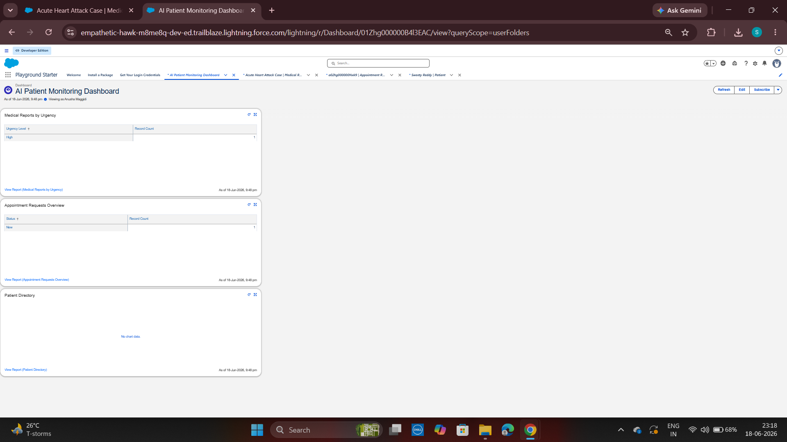
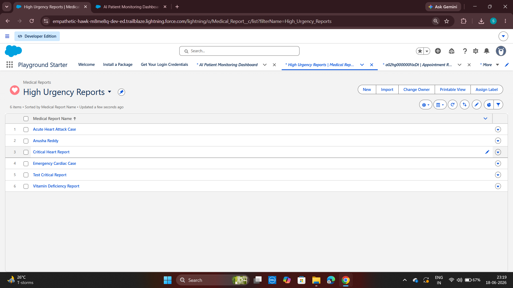
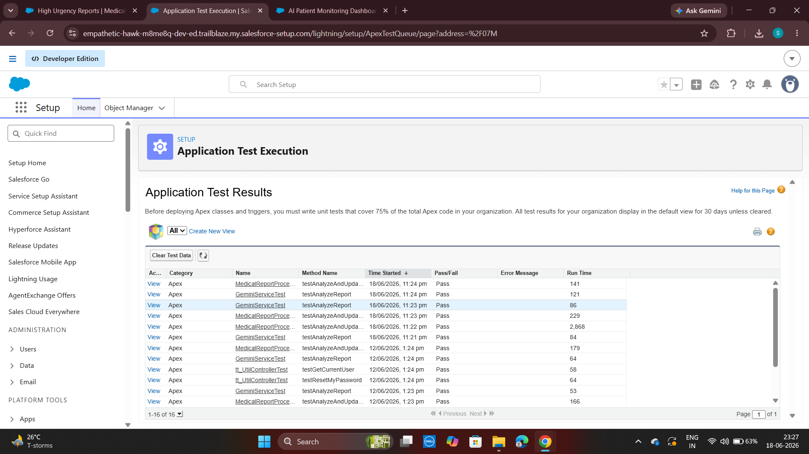

# AI Patient Support & Medical Report Simplifier

A Salesforce-based patient support application that uses Google's Gemini API to turn
medical report text into a plain-language summary, classify its urgency, suggest a next
step, and automatically create an appointment request for high-urgency reports.

> This is a patient-support and report-understanding tool. It does not diagnose
> conditions or replace a doctor. Every analysis includes a medical disclaimer.

## Problem Statement

Medical reports often contain complex medical terminology that can be difficult for
patients to understand. Patients may struggle to identify the important findings,
understand the urgency of their reports, and determine what action they should take next.

This project is a Salesforce-based patient support system that uses the Gemini API to
analyze medical report text, generate easy-to-understand summaries, classify the report's
urgency, and suggest appropriate next steps. It also helps manage patient records and
appointment requests, particularly for reports classified as high urgency.

## What It Does

- Accepts medical report text on a Medical Report record.
- Uses the Gemini API to generate a simplified summary.
- Classifies urgency as **Low**, **Moderate** or **High**.
- Suggests a next action and stores a medical disclaimer.
- Stores the analysis and the analysis date on the report in Salesforce.
- Updates the report status based on urgency.
- Automatically creates an Appointment Request for high-urgency reports, without
  creating duplicates.
- Provides list views, reports and a dashboard to monitor reports and appointments.

| Urgency | Medical Report Status | Appointment Request |
|---|---|---|
| High | Escalated | Created (Status = New), unless one already exists |
| Moderate | In Progress | Not created |
| Low | Reviewed | Not created |

## Tech Stack

Salesforce Platform (Developer Edition) · Apex · SOQL · HTTP callouts · Named and External
Credentials · Gemini API (`gemini-2.5-flash`) · JSON serialization/deserialization ·
Reports and Dashboards · Salesforce CLI · Git and GitHub

## Architecture

```text
Medical Report (Report_Text__c)
        ↓
MedicalReportProcessor.analyzeAndUpdateReport(reportId)
        ↓
GeminiService.analyzeReport(text) ── callout:Gemini_API ──► Gemini API
        ↓                                                    (JSON response)
ReportAnalysisResponse (summary, urgency, recommendation, disclaimer)
        ↓
Medical Report updated: AI Summary, Urgency, Suggested Action,
                        Disclaimer, Status, Analysis Date
        ↓
High urgency and no existing appointment → Appointment Request (New)
        ↓
List views, reports and dashboard
```

Analysis is started by calling `MedicalReportProcessor.analyzeAndUpdateReport(reportId)`,
for example from Anonymous Apex (see `scripts/apex/analyze-report.apex`). There is no
trigger or Flow. More detail: [docs/architecture.md](docs/architecture.md).

## Data Model

| Object | Purpose | Key fields |
|---|---|---|
| `Patient__c` | Patient information | Age, Gender, Email, Phone, Notes |
| `Medical_Report__c` | Report text and its AI analysis | Patient (lookup), Report Text, AI Summary, Urgency Level, Suggested Action, Disclaimer, Status, Analysis Date |
| `Appointment_Request__c` | Appointment requests for high-urgency reports | Patient (lookup), Medical Report (lookup), Status, Preferred Date, Preferred Time, Notes |

## Apex Classes

| Class | Responsibility |
|---|---|
| `GeminiService` | Builds the prompt (including triage rules), calls Gemini through the Named Credential with JSON mode and temperature 0, and raises `GeminiApiException` on non-200 responses. |
| `MedicalReportProcessor` | Parses the response, applies safe defaults, maps urgency to status, updates the report and creates an appointment for High urgency after checking for an existing one. |
| `ReportAnalysisResponse` | Wrapper class for JSON deserialization. |
| `GeminiMockResponse` | `HttpCalloutMock` used by the tests. |

## Security

- The Gemini API key is stored in an encrypted **External Credential** principal parameter
  and added to requests as the `x-goog-api-key` header through a `$Credential` formula.
- The key is not in Apex code, metadata or this repository.

## Testing

10 Apex unit tests, all passing, with mocked HTTP callouts (no real API calls):

| Class | Coverage |
|---|---|
| `GeminiService` | 100% |
| `MedicalReportProcessor` | 98% |

The tests cover the request configuration, API errors, High urgency with appointment
creation, duplicate prevention, Moderate and Low urgency without appointments, and
default values for incomplete AI responses.

```bash
sf apex run test --class-names GeminiServiceTest --class-names MedicalReportProcessorTest --code-coverage --result-format human --target-org <alias>
```

## Reports, Dashboard and List Views

- **Reports:** Medical Reports by Urgency, Appointment Requests Overview, Patient Directory
- **Dashboard:** AI Patient Monitoring Dashboard
- **List views:** High Urgency Reports, Recent Medical Reports (last 30 days),
  Pending Appointment Requests (status New)

## Setup

See **[docs/RECOVERY.md](docs/RECOVERY.md)** for step-by-step deployment to a new org. In short:

1. Authorize an org: `sf org login web --alias ai-patient-org --set-default`
2. Deploy: `sf project deploy start --manifest manifest/project-package.xml --test-level RunSpecifiedTests --tests GeminiServiceTest --tests MedicalReportProcessorTest`
3. Assign access: `sf org assign permset --name AI_Patient_Support_Access`
4. Add the Gemini API key to the `Gemini_External_Credential` principal (Setup only).
5. Create demo data: `sf apex run --file scripts/apex/create-demo-data.apex`
6. Analyze a report: `sf apex run --file scripts/apex/analyze-report.apex`

## Challenges and Solutions

| Challenge | Solution |
|---|---|
| Gemini responses were wrapped in Markdown code blocks, breaking JSON parsing. | Stripped code fences before deserializing; later enabled Gemini JSON response mode. |
| Missing values caused null pointer exceptions. | Added null checks and default values. |
| Repeated analysis created duplicate appointments. | Query for an existing appointment before inserting a new one. |
| The same report was sometimes classified differently. | Added explicit triage rules to the prompt, temperature 0 and no thinking step. |
| API errors surfaced as null pointer exceptions. | Check the HTTP status and raise `GeminiApiException` with Gemini's error message. |
| The API key was stored as plain text in credential metadata. | Moved it to an encrypted External Credential principal parameter. |
| Retrieving the whole org pulled in unrelated standard metadata. | Removed it from the repository and added a project-only deployment manifest (`manifest/project-package.xml`). |

## Limitations

- Analysis is started manually; only one report can be analyzed per transaction because
  Salesforce does not allow a callout after DML in the same transaction.
- The Gemini free tier has a small daily request quota.
- AI output can still vary for borderline reports; it is guidance, not a diagnosis.

## Future Enhancements

- Run analysis asynchronously (Queueable with callouts) so it can start automatically when
  a report is saved.
- Lightning Web Component for patients to view their simplified report.
- Email notifications for high-urgency cases.
- File upload for PDF reports.
- Electronic Health Record (EHR) integration.

## Project Structure

```text
ai-patient-support-agentforce
├── force-app/main/default/
│   ├── classes/            # Apex classes and tests
│   ├── objects/            # Patient, Medical Report, Appointment Request
│   ├── namedCredentials/   # Gemini_API
│   ├── externalCredentials/# Gemini_External_Credential (no secrets)
│   ├── permissionsets/     # AI_Patient_Support_Access
│   ├── reports/  dashboards/  reportTypes/
│   └── layouts/  tabs/
├── manifest/project-package.xml   # Project-only deployment manifest
├── scripts/apex/           # Demo data and analysis scripts
├── docs/                   # Architecture, AI contract, triage rules, recovery guide, demo script
├── screenshots/
└── sfdx-project.json
```

## Screenshots

### Gemini API Integration



### Medical Report Analysis



### Appointment Request



### Dashboard



### High Urgency Reports List View



### Apex Test Results



## Author

**Anusha Maggidi**
Aspiring Software Developer passionate about building AI-powered solutions and solving
real-world problems through technology.
GitHub: https://github.com/maggidi-anusha
